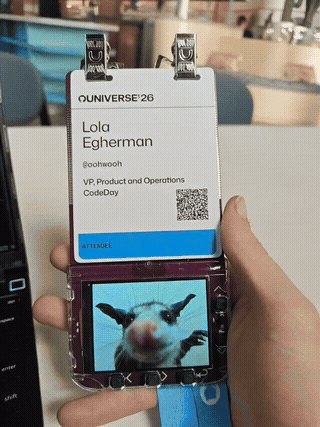

# Universe Badge Slideshow

Add a slideshow of images to your GitHub Universe badge!

# Installation
- clone this repo
- add the images you want to display to the `input/` folder
- resize the images to the badge screen resolution (320x240px)`python resize_images.py`
- copy `slideshow` inside your badge's `apps` folder (plug in via USB and enter the "mass storage" app if it doesnt start automatically)

